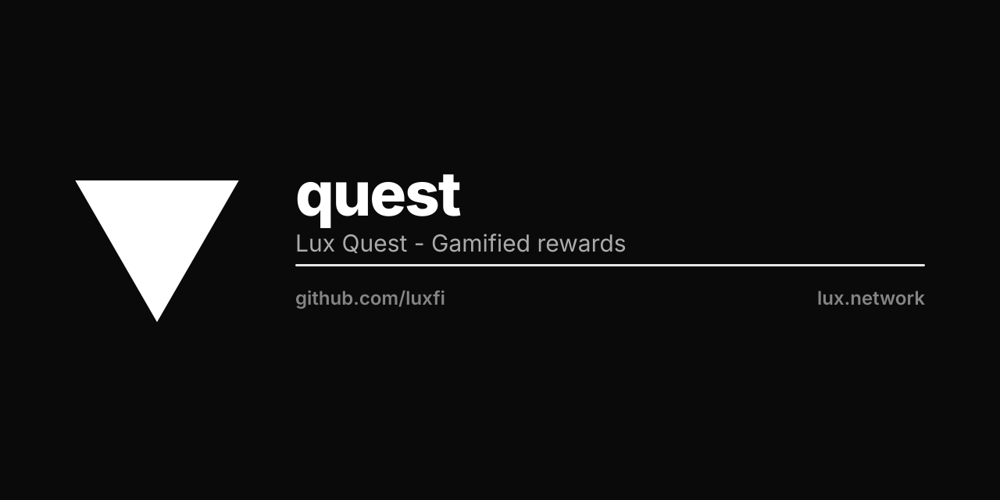

<p align="center"></p>

# Lux Quest

Build a scavenger hunt out of real places and send it to a friend. They walk the
city to solve it — clue by clue, checking in when they arrive.

```
pnpm install
pnpm dev          # http://localhost:3000
pnpm test         # unit — codec, distance maths, saved progress
pnpm e2e          # browser — the whole game loop, with faked GPS
pnpm build        # static export to out/
```

## How it works

A quest is a **value**, not a database row. The name, the prize and every stop
encode into the share link, so making one and sending it needs no account, no
server and no storage. There is nothing to sign up for and no copy is kept.

The code rides in the URL **fragment** (`/play#…`), never the query string. A
fragment is not sent to the server and does not appear in a `Referer` header, so
the places someone chose stay out of access logs and off any site they click
through to. Moving it to `?q=` would quietly publish every quest anyone shares.

Play progress is `localStorage`, keyed by a hash of the share code — so two
quests never collide, and editing one starts a clean run rather than inheriting
the old run's finds.

## Arriving

A stop is found when the device reports a position within its radius. The
browser's own accuracy estimate is **added** to that radius: a phone between tall
buildings routinely reports ±50 m, and holding it to the bare radius tells
someone standing at the right door that they are not there. Wildly inaccurate
readings are capped, so a device claiming ±50 km cannot unlock a city from the
sofa.

## Google Maps

Set `NEXT_PUBLIC_GOOGLE_MAPS_KEY` to render the map. Without it the app still
works: every stop falls back to a list with a Google Maps link, so a hunt is
playable with no key at all. The two failure modes are told apart on purpose —
*no key configured* is not the same as *Google refused*, and collapsing them is
how a missing environment variable gets mistaken for an outage.

## Prizes

Whatever the maker offers, in their own words, settled directly between the two
of them. Lux Quest holds no money, takes no payment and hands nothing out —
anything else is a custody problem, and pretending otherwise in the UI would be a
lie about what happens when someone wins.

## Layout

```
src/lib/quest.ts     the value + its codec        pure
src/lib/geo.ts       distance, and "am I there"   pure
src/lib/progress.ts  what this device has found   localStorage
src/lib/maps.ts      the only module that knows Google exists
src/components/      the map, and its no-key fallback
src/app/             landing · /create · /play
```

The pure modules hold every rule worth arguing about, which is why they are
tested without a browser, a network or a device. The e2e suite fakes geolocation
rather than stubbing the app, so the production `navigator.geolocation` path and
the real arrival maths both run: a unit test cannot prove that someone standing
at Clarion Alley gets their point.

Built on Next 15 (static export), Tailwind, `@luxfi/ui`.
